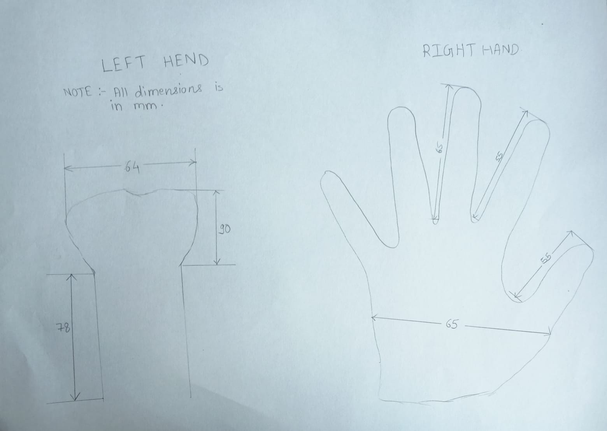

# 3D-Printed Prosthetic Hand — Body-Powered, Cord-Driven Prototype

**Group 25** · **Krushna Uday Bothe** (PRN 2126UMEM1006)  
**Website:** https://krushnabothe0702-dot.github.io/3D-Printed-Prosthetic-Hand/

A student engineering project at **Sanjivani University**: a low-cost mechanical hand made of 3D-printed parts, cord and elastic. Bending the wrist pulls cords (artificial tendons) that curl the fingers; elastic on the back of each finger opens them again. No motors or batteries.


> **Status:** all parts sliced, printed and assembled; tendons routed and tensioned. First tabletop grasp demonstrated — the hand picked up a roll of tape ([video](media/videos/grasp-test.mp4)). Measured testing is next — no grip-strength results are claimed yet.

## Who it is for


A partial-hand limb difference with a working wrist. The remaining wrist movement is what drives this design: bending the wrist pulls the cords and closes the printed fingers.

## How it works

1. **Pull cords (tendons)** run from each fingertip along the palm side, through the palm, to anchors on the gauntlet.
2. **Hinged finger segments** are joined by pins so each finger can curl.
3. **Wrist drive** — the palm pivots on the gauntlet; bending the wrist tightens the cords and closes the fingers.
4. **Elastic return** — red elastic on the back of each finger straightens it when the wrist relaxes.

## Build journey

| Step | What we did | Media |
|---|---|---|
| 1 | Hand sketch with measurements → proposed printable dimensions | [design notes](docs/design-notes.md) |
| 2 | Arranged and sliced all parts | [video](media/videos/slicing-parts.mp4) |
| 3 | 3D-printed the parts on a Bambu Lab H2D (white filament, FDM, with supports) | [video](media/videos/printing-parts.mp4) |
| 4 | Pinned the joints, routed the tendons | — |
| 5 | Tied off and tensioned the cords at the gauntlet (Krushna Bothe) | [photo](media/photos/krushna-bothe-tensioning-cords.jpg) |
| 6 | Complete prototype | [photo](media/photos/hand-gauntlet-underside.jpg) |
| 7 | Checked the finger joints and cord movement | — |
| 8 | First grasp test: picked up a roll of tape (bench, not worn) | [video](media/videos/grasp-test.mp4) |

## CAD model (SOLIDWORKS)


- Assembly: [`cad/group 25 hand assembly.SLDASM`](cad/group%2025%20hand%20assembly.SLDASM) with its 16 part files in [`cad/Hand Parts`](cad/Hand%20Parts)
- STEP (no SOLIDWORKS needed): [`cad/group-25-hand-assembly.step`](cad/group-25-hand-assembly.step)
- 29 components, 39 mates, about 117 × 218 × 74 mm overall
- Full parts list: [cad/README.md](cad/README.md)

**Design source:** based on the open-source [e-NABLE Phoenix Hand](https://enablingthefuture.org/phoenix-hand/) ([Thingiverse 1453190](https://www.thingiverse.com/thing:1453190)), licensed CC BY-NC-SA.

## Hand measurement drawing



Left hand (partial hand, the side the device is for): palm 64 wide × 90 high, 78 mm section below the wrist. Right hand (reference for finger sizes): middle finger 65, other fingers and thumb 55, palm width 65. All in mm.

## Machines

| Machine | Used? | Purpose |
|---|---|---|
| **Bambu Lab H2D** (FDM, 2 nozzles, 325 × 320 × 325 mm) | ✅ Yes | Printed every part of the hand |
| **CO2 laser cutter** by SIL (silasers.com) | ❌ Not used | Available in the makerspace; could cut straps, padding or a display stand in a later version |

Details and photos: [docs/machines.md](docs/machines.md)

## Design dimensions (design values, not as-built)

| Part | Proposed dimension |
|---|---:|
| Palm (width × height × thickness) | 64 × 90 × 12 mm |
| Thumb (height × width) | 55 × 20 mm |
| Middle finger (height × width) | 65 × 14 mm |
| Index, ring & little fingers (height × width) | 55 × 14 mm each |
| Hinge holes | ⌀4.3 mm |
| Forearm attachment | 250 mm, separate part |

See [docs/design-notes.md](docs/design-notes.md) for the original sketch measurements and why the finger length was changed.

## Repository layout

```
index.html            Project website (GitHub Pages)
assets/               Website styles, script, icon and share image
media/photos/         Real photographs of the build
media/videos/         Slicing and printing videos
docs/                 Design notes, build guide, machines
cad/                  SOLIDWORKS assembly, 16 part files, STEP export, parts list
```

## Next steps

- Measured bench test: wrist angle to close all five fingers evenly, and reliable reopening
- More grasp tests with light objects (cup, ball, bottle); record results
- Measure as-built dimensions; add STL files and print settings

## Safety

Educational, non-clinical prototype. Not load-tested, fitted, or reviewed by a prosthetist. Do not use it for heavy loads or wear it on a limb without review by a qualified clinician or engineer.

## Team

| # | Name | PRN |
|---|---|---|
| 1 | Krushna Uday Bothe | 2126UMEM1006 |

- Project guide: *to be added*
- Sanjivani University
