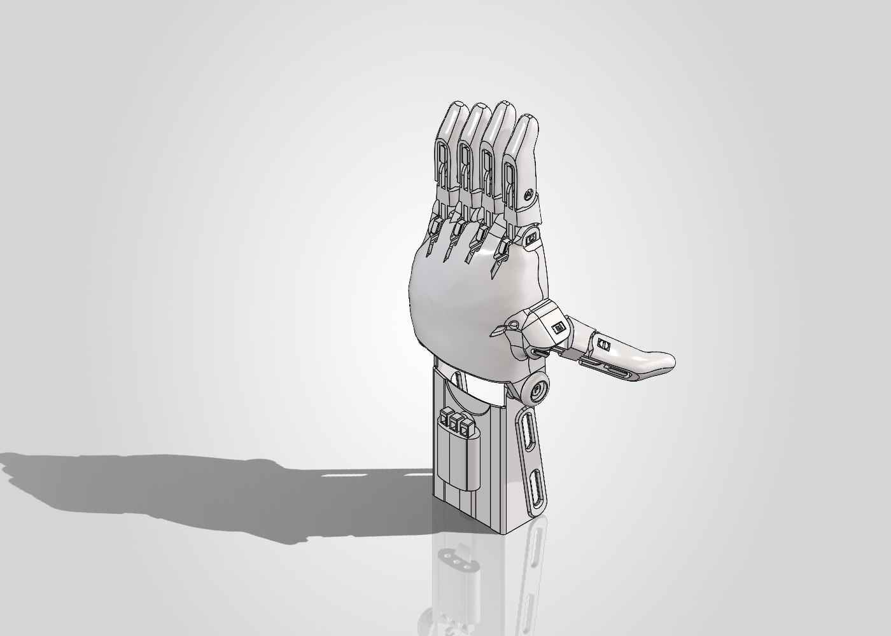

# CAD files — Group 25 Hand Assembly (SOLIDWORKS)

## Files in this folder

| File | What it is |
|---|---|
| `group 25 hand assembly.SLDASM` | Full SOLIDWORKS assembly of the hand (29 components, 39 mates) |
| `Hand Parts/*.SLDPRT` | The 16 part files the assembly uses — keep this folder next to the assembly |
| `group-25-hand-assembly.step` | STEP export of the whole assembly, for anyone without SOLIDWORKS (opens in FreeCAD, Fusion, Onshape, etc.) |

**To open:** download the whole `cad` folder, keep `Hand Parts` beside the `.SLDASM`, then open the assembly in SOLIDWORKS. If it asks for missing files, point it to the `Hand Parts` folder.

## Parts list (bill of materials)

Sizes are the overall bounding box of each part, measured from the CAD model.

| # | Part file | What it is | Qty | Approx. size (mm) |
|---|---|---|---:|---|
| 1 | `Palm_Left.SLDPRT` | Palm (left hand) | 1 | 92 × 83.5 × 31.4 |
| 2 | `Proximal_Finger.SLDPRT` | Finger base segment | 4 | 35.6 × 16.2 × 12.5 |
| 3 | `Distal_Long.SLDPRT` | Fingertip, long | 2 | 44.1 × 15.9 × 11.4 |
| 4 | `Distal_Short.SLDPRT` | Fingertip, short | 2 | 40.2 × 15.2 × 11.5 |
| 5 | `Proximal_Thumb.SLDPRT` | Thumb base segment | 1 | 35.6 × 17.3 × 16.4 |
| 6 | `Distal_Thumb.SLDPRT` | Thumb tip | 1 | 44.1 × 16.4 × 16.2 |
| 7 | `Gauntlet_Formed.SLDPRT` | Gauntlet (forearm piece) | 1 | 87 × 48.9 × 31.5 |
| 8 | `Pin_A_Finger.SLDPRT` | Fingertip joint pin | 4 | 10.5 × 5 × 3.9 |
| 9 | `Pin_B_Short_Knuckle.SLDPRT` | Knuckle pin, short | 2 | 13 × 5.5 × 3.3 |
| 10 | `Pin_C_Long_Knuckle.SLDPRT` | Knuckle pin, long | 1 | 27 × 5.5 × 3.3 |
| 11 | `Pin_D_Thumb_Mid.SLDPRT` | Thumb middle-joint pin | 1 | 13.3 × 5 × 4 |
| 12 | `Pin_E_Thumb_Base.SLDPRT` | Thumb base pin | 1 | 16 × 5.5 × 3.3 |
| 13 | `Pin_F_Wrist.SLDPRT` | Wrist hinge pin | 2 | 13.8 × 6.8 × 4.4 |
| 14 | `Wrist_Pin_Cap.SLDPRT` | Wrist pin cap | 2 | 16.5 × 16.5 × 3.8 |
| 15 | `Tensioner_Block.SLDPRT` | Cord tensioner block | 1 | 28 × 23.2 × 11 |
| 16 | `Tensioner_Pin.SLDPRT` | Cord tensioner pin | 3 | 33.1 × 4.8 × 4.8 |
| | **Total** | 16 different parts | **29** | |

Overall size of the assembled hand in the modelled pose (fingers straight, thumb out): about **117 × 218 × 74 mm**.

Not modelled in CAD: tendon cords, return elastics, straps and padding.

## Design source and license

This hand is based on the **e-NABLE Phoenix Hand** — an open-source, wrist-driven 3D-printable hand from the e-NABLE community (credited to Jason Bryant's design, with components by John Diamond, Scott Darrow and Andreas Bastian). Original files: https://www.thingiverse.com/thing:1453190 · About: https://enablingthefuture.org/phoenix-hand/

The original design is shared under a **Creative Commons Attribution-NonCommercial-ShareAlike** license. The CAD files in this folder follow the same terms: credit the original designers, no commercial use, and share changes under the same license.

## Team

Group 25 — 3D-Printed Prosthetic Hand, Sanjivani University

| # | Name | PRN |
|---|---|---|
| 1 | Krushna Uday Bothe | 2126UMEM1006 |

Project guide: *to be added*
