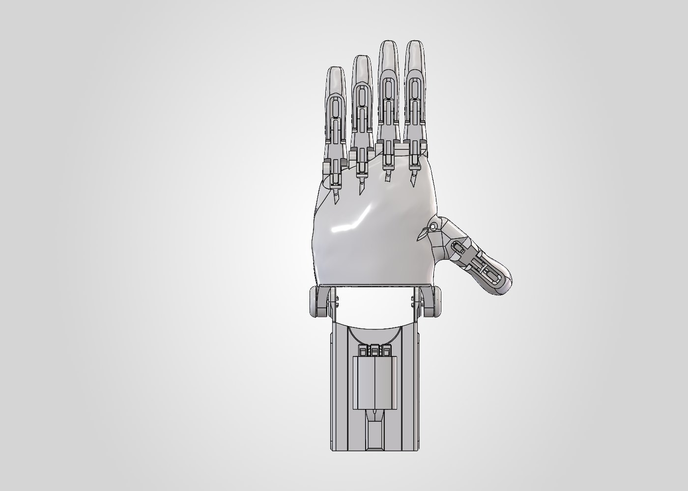
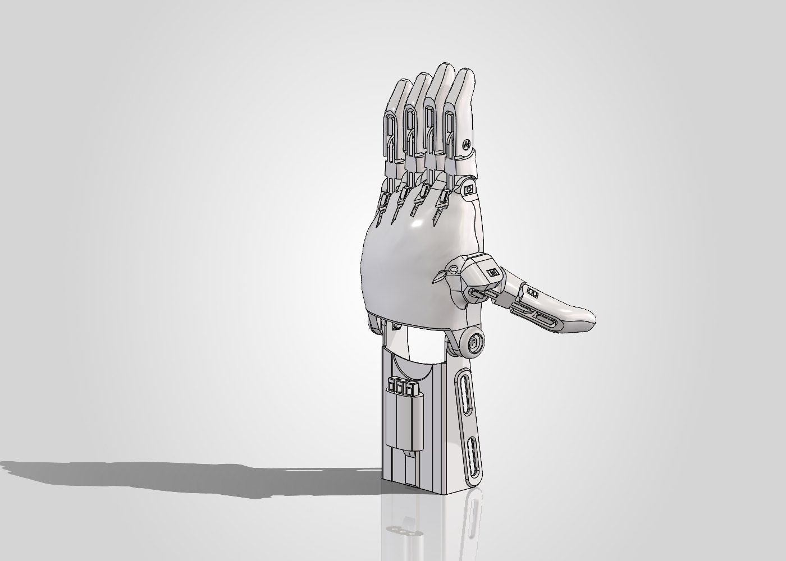

# Design notes

## 1. Original sketch measurements

The project started from a hand-drawn sketch of the palm, fingers and a forearm section. The measurements read from it were:

| Part | Measurement |
|---|---:|
| Forearm section | 25 cm (250 mm) |
| Palm height | 9 cm (90 mm) |
| Palm width | 6.4 cm (64 mm) |
| Finger length (as drawn) | 20 cm (200 mm) |
| Finger spread / height | 10 cm (100 mm) |

Some values may be misread because of the drawing's orientation.

## 2. Proposed printable dimensions

A literal 200 mm finger is far longer than a human finger, so the printable design uses a 65 mm middle finger and 55 mm for the other fingers and the thumb.

| Part | Proposed dimension |
|---|---:|
| Palm (width × height × thickness) | 64 × 90 × 12 mm |
| Thumb (height × width) | 55 × 20 mm |
| Middle finger (height × width) | 65 × 14 mm |
| Index, ring & little fingers (height × width) | 55 × 14 mm each |
| Hinge holes | ⌀4.3 mm |
| Forearm attachment | 250 mm, designed as a separate part |

The forearm attachment is kept separate so its length and fit can change without reprinting the palm.

These are **design values**. The as-built hand has not been measured yet.

## 3. Control method

Mechanical strings operated by wrist movement (body-powered). No servos or electronics.

- **Pull cord:** one cord per finger, running along the palm side, pulls the finger inward.
- **Hinges:** pins between printed segments let each finger bend.
- **Return:** light elastic on the back of each finger reopens it when the pull is released.
- **Wrist drive:** bending the wrist tightens the cords; this linkage needs its own testing and tuning.

## 4. Materials

- Printed parts: white filament, FDM printing (PLA is recommended for first fit-checks)
- Tendons: braided cord
- Return: elastic cord / bands
- Pins: printed pins or suitable small bolts; no sharp exposed ends

## 5. CAD assembly (SOLIDWORKS)

The hand is modelled as a SOLIDWORKS assembly: [`cad/group 25 hand assembly.SLDASM`](../cad/group%2025%20hand%20assembly.SLDASM), with a STEP copy at [`cad/group-25-hand-assembly.step`](../cad/group-25-hand-assembly.step).

| Front | Dimetric |
|---|---|
|  |  |

- **29 components** (16 different parts), positioned by **39 mates**
- Overall size in the modelled pose: about **117 × 218 × 74 mm**
- Palm part (`Palm_Left`) bounding box from CAD: **92 × 83.5 × 31.4 mm** (includes the knuckle and wrist features)
- Full parts list with quantities and sizes: [cad/README.md](../cad/README.md)

Based on the e-NABLE Phoenix Hand (CC BY-NC-SA) — see [cad/README.md](../cad/README.md#design-source-and-license).

## Team

Group 25 — 3D-Printed Prosthetic Hand, Sanjivani University

| # | Name | PRN |
|---|---|---|
| 1 | Vaibhav Sampat Dighe | 2126UMEM1061 |
| 2 | Krushna Uday Bothe | 2126UMEM1006 |
| 3 | Tanmay Vijay Matade | 2126UMEM1074 |
| 4 | Pranav Dhus | 2126UMEM1075 |

Project guide: *to be added*
