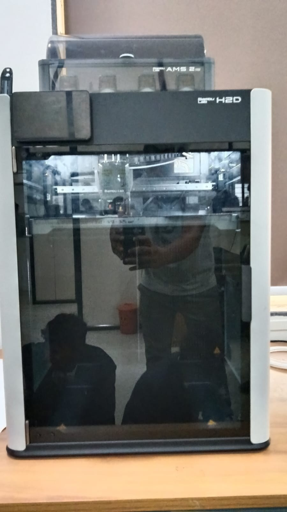
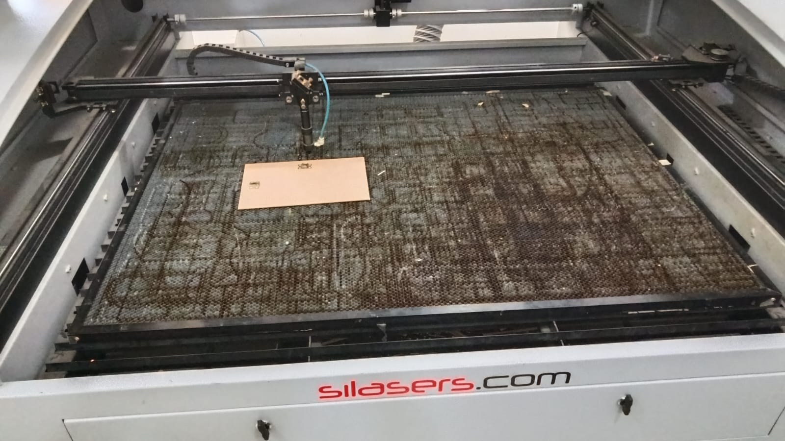

# Machines

## Bambu Lab H2D — 3D printer (used)

Every printed part of the hand (palm, fingers, thumb, gauntlet, pins, tensioner) was sliced in Bambu Studio and printed on a **Bambu Lab H2D** in white filament, with supports under overhangs. An AMS filament unit sits on top and feeds filament automatically.

| Specification (manufacturer) | Value |
|---|---|
| Process | FDM, 2 nozzles |
| Build volume, single nozzle | 325 × 320 × 325 mm |
| Build volume, both nozzles | 300 × 320 × 320 mm |
| Max nozzle temperature | 350 °C |
| Max bed temperature | 120 °C |
| Heated chamber | up to 65 °C |
| Max toolhead speed | 1000 mm/s |
| Materials | PLA, PETG, TPU, ABS, ASA, PC, PA and more |

Source: https://bambulab.com/en/h2d/tech-specs

## CO2 laser cutter — SIL (silasers.com) (not used in this project)

A CO2 laser cutting and engraving machine made by Suresh Indu Lasers (SIL), Pune, available in the makerspace. A focused laser beam moves on an X–Y gantry over a honeycomb bed and cuts or engraves flat sheets from a 2D drawing (DXF/SVG).

**It was not used for this prosthetic hand** — all hand parts are 3D-printed.

- **Can cut / engrave:** MDF, plywood, acrylic, leather, fabric, felt, paper, cardboard (non-metals)
- **Possible uses in a later version:** leather or fabric straps and padding for the gauntlet, an acrylic/MDF display and test stand, engraved part labels
- **Safety:** never cut PVC or vinyl (toxic chlorine gas); always run fume extraction; never leave it running unattended

Manufacturer: https://silasers.com/ — the exact model, bed size and laser power of the makerspace machine are not recorded here.

## Team

Group 25 — 3D-Printed Prosthetic Hand, Sanjivani University

| # | Name | PRN |
|---|---|---|
| 1 | Krushna Uday Bothe | 2126UMEM1006 |

Project guide: *to be added*
